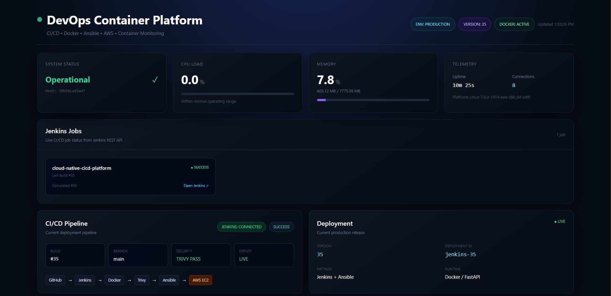
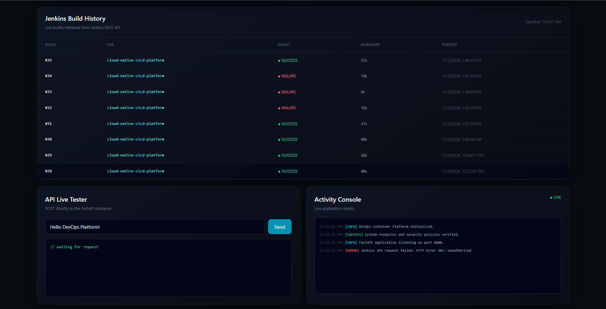
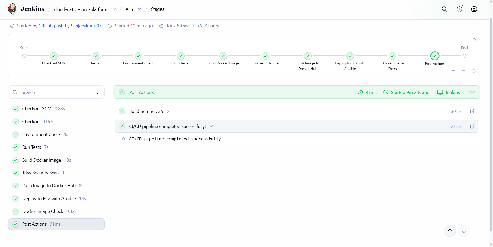
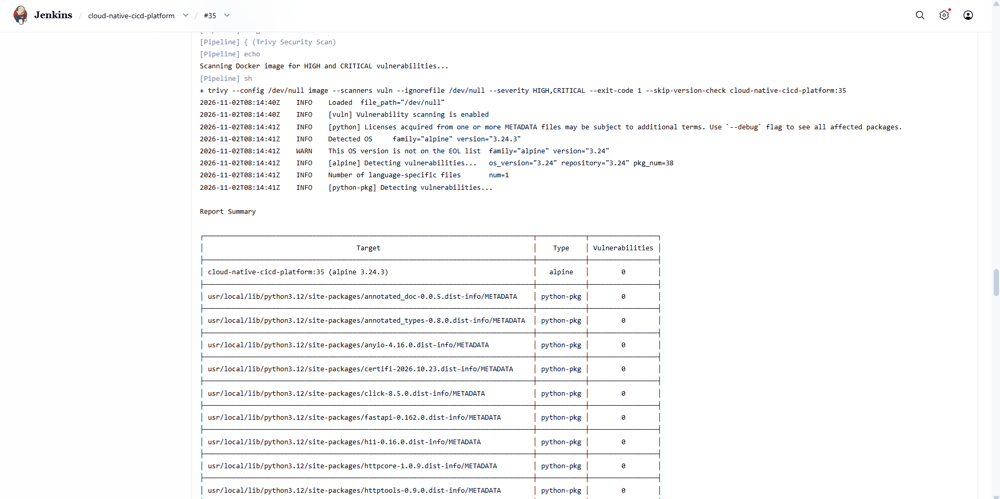
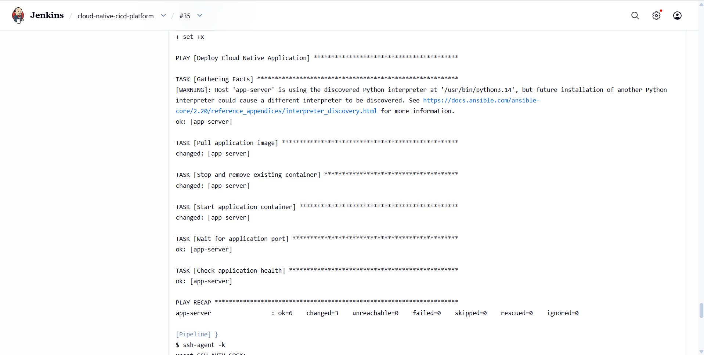
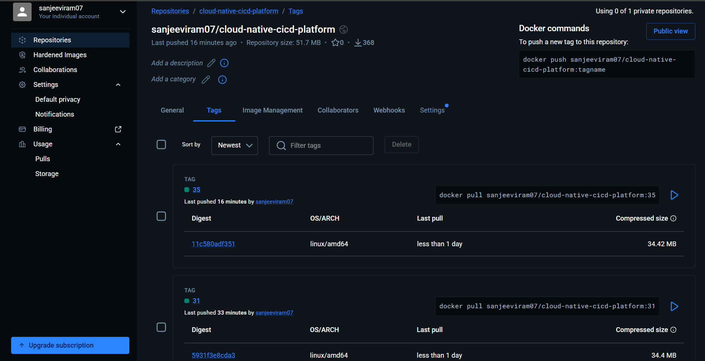
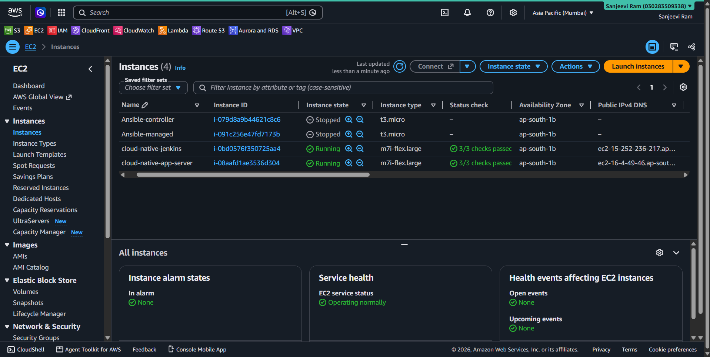

# 🚀 Cloud-Native CI/CD Platform

> **Production-style CI/CD platform for automated testing, container security scanning, image publishing, and deployment to AWS EC2 using Jenkins, Docker, Trivy, and Ansible.**

[](https://www.jenkins.io/)
[](https://aws.amazon.com/)
[](https://www.docker.com/)
[](https://www.ansible.com/)
[](https://fastapi.tiangolo.com/)
[](https://trivy.dev/)

---

## 📌 Overview

**Cloud-Native CI/CD Platform** is a production-style DevOps project that automates the complete application delivery lifecycle from **GitHub source code changes to deployment on an AWS EC2 server**.

The platform integrates:

- GitHub for source control
- Jenkins for CI/CD orchestration
- Pytest for automated testing
- Docker for containerization
- Trivy for container vulnerability scanning
- Docker Hub for image distribution
- Ansible for automated deployment
- Ansible Vault for secret management
- AWS EC2 for infrastructure
- FastAPI for the application and monitoring APIs
- GitHub Webhooks for automatic pipeline triggering
- A custom dashboard for real-time deployment and infrastructure visibility

A developer only needs to:

```bash
git push
```

The rest of the deployment workflow is automated.

---

# 🏗️ Architecture

```text
                         ┌──────────────────┐
                         │      GitHub      │
                         │  Source Control  │
                         └────────┬─────────┘
                                  │
                                  │ Push
                                  ▼
                         ┌──────────────────┐
                         │ GitHub Webhook   │
                         └────────┬─────────┘
                                  │
                                  ▼
┌─────────────────────────────────────────────────────────────┐
│                     Jenkins EC2 Server                      │
│                                                             │
│  ┌──────────┐   ┌──────────┐   ┌──────────┐               │
│  │ Checkout │ → │  Pytest  │ → │  Docker  │               │
│  └──────────┘   └──────────┘   └────┬─────┘               │
│                                      │                     │
│                                      ▼                     │
│                              ┌──────────────┐              │
│                              │    Trivy     │              │
│                              │ Vulnerability│              │
│                              │     Scan     │              │
│                              └──────┬───────┘              │
│                                     │                      │
│                                     ▼                      │
│                              ┌──────────────┐              │
│                              │  Docker Hub  │              │
│                              └──────┬───────┘              │
│                                     │                      │
│                                     ▼                      │
│                              ┌──────────────┐              │
│                              │    Ansible   │              │
│                              └──────┬───────┘              │
└─────────────────────────────────────┼───────────────────────┘
                                      │
                                      │ SSH
                                      ▼
                         ┌──────────────────────┐
                         │   Application EC2    │
                         │                      │
                         │  Docker Container    │
                         │  ┌────────────────┐  │
                         │  │    FastAPI     │  │
                         │  │     :8000      │  │
                         │  └────────────────┘  │
                         └───────────┬──────────┘
                                     │
                                     ▼
                         ┌──────────────────────┐
                         │   Live Dashboard     │
                         │                      │
                         │ • Jenkins Status     │
                         │ • Build History      │
                         │ • CPU / Memory       │
                         │ • Deployment Status  │
                         │ • Application Health │
                         └──────────────────────┘
```

---

# 🔄 CI/CD Pipeline

Every push to the `main` branch can automatically trigger the Jenkins pipeline through a **GitHub Webhook**.

```text
Developer
    │
    │ git push
    ▼
GitHub
    │
    │ Webhook
    ▼
Jenkins
    │
    ├── Checkout Source
    │
    ├── Environment Check
    │
    ├── Create Python Virtual Environment
    │
    ├── Install Dependencies
    │
    ├── Run Pytest
    │
    ├── Build Docker Image
    │
    ├── Trivy Security Scan
    │
    ├── Push Image to Docker Hub
    │
    ├── Deploy using Ansible
    │
    ├── Health Check
    │
    └── Deployment Complete
```

---

# ⚙️ Pipeline Stages

## 1. Checkout

Jenkins automatically retrieves the latest source code from GitHub.

```text
GitHub → Jenkins Workspace
```

---

## 2. Environment Check

The pipeline verifies that the required DevOps tools are available:

- Python
- Git
- Docker
- Ansible
- Trivy

Example:

```bash
python3 --version
git --version
docker --version
ansible --version
trivy --version
```

---

## 3. Automated Testing

A fresh Python virtual environment is created for every build.

```bash
python3 -m venv .venv
.venv/bin/python -m pip install -r requirements.txt
.venv/bin/python -m pytest -v
```

The application currently includes automated tests using **Pytest**.

---

## 4. Docker Build

The application is packaged into a Docker image.

```bash
docker build -t cloud-native-cicd-platform:${BUILD_NUMBER} .
```

Each Jenkins build receives a unique image tag.

Example:

```text
cloud-native-cicd-platform:30
cloud-native-cicd-platform:31
cloud-native-cicd-platform:32
```

This provides build-level versioning for deployments.

---

## 5. Container Security with Trivy

Before deployment, the Docker image is scanned using **Trivy**.

The pipeline checks for:

```text
HIGH
CRITICAL
```

severity vulnerabilities.

A build fails when the configured security scan detects blocking vulnerabilities.

This prevents vulnerable container images from automatically reaching the deployment stage.

---

# 🐳 Docker Image Publishing

After a successful security scan, the image is tagged and pushed to Docker Hub.

```text
Jenkins
   │
   ▼
Docker Image
   │
   ▼
Trivy Scan
   │
   ▼
Docker Hub
```

Images are versioned using the Jenkins build number.

Example:

```text
sanjeeviram07/cloud-native-cicd-platform:30
```

---

# 🤖 Automated Deployment with Ansible

Ansible handles deployment to the application EC2 instance.

The deployment process:

```text
Jenkins
   │
   │ SSH
   ▼
Application EC2
   │
   ├── Pull latest Docker image
   │
   ├── Stop old container
   │
   ├── Remove old container
   │
   ├── Start new container
   │
   └── Verify application health
```

The deployment uses:

```text
Ansible
Ansible Vault
Docker
SSH
AWS EC2
```

---

# 🔐 Secret Management

Sensitive credentials are not hard-coded into the application or Jenkinsfile.

The project uses:

### Jenkins Credentials

Used for:

- Docker Hub authentication
- Ansible SSH authentication
- Ansible Vault password

### Ansible Vault

Sensitive deployment variables such as Jenkins authentication details are encrypted using Ansible Vault.

Example:

```text
vault.yml
```

is stored encrypted rather than exposing credentials in plaintext.

---

# ☁️ AWS Infrastructure

The project uses two EC2 instances.

### EC2 #1 — Jenkins Server

Responsible for:

- Jenkins
- Docker
- Ansible
- Trivy
- AWS CLI
- CI/CD orchestration

### EC2 #2 — Application Server

Responsible for:

- Docker runtime
- FastAPI application
- Application container
- Health checks
- Production-style application deployment

---

# 📊 Live DevOps Dashboard

The project includes a custom web dashboard that provides real-time visibility into the CI/CD platform.

### Dashboard features

- 🟢 System status
- 🔗 Jenkins API connection
- 🏗️ Latest Jenkins build
- 📜 Build history
- 🛡️ Trivy security status
- 🚀 Deployment status
- 🐳 Container information
- 💻 CPU utilization
- 🧠 Memory utilization
- ⏱️ Application uptime
- 🔌 Active connections
- 🧪 API Live Tester
- 📋 Activity console
- 📦 Application version
- 🔖 Deployment ID

The dashboard communicates with the FastAPI backend through REST APIs.

---
## 📸 Project Screenshots

### Live DevOps Dashboard





### Jenkins CI/CD Pipeline



### Automated Security Scan



### Automated Ansible Deployment



### Docker Image Repository



### AWS Infrastructure



---

# 🔌 API Endpoints

The FastAPI application exposes operational endpoints for health monitoring and dashboard integration.

| Endpoint | Purpose |
|---|---|
| `/` | Application landing/API information |
| `/healthz` | Application health check |
| `/api/metrics` | Live application metrics |
| `/api/jenkins` | Jenkins build and job information |

Example health response:

```json
{
  "status": "healthy"
}
```

Example metrics:

```json
{
  "status": "healthy",
  "application": "DevOps Container Platform",
  "version": "30",
  "environment": "production",
  "deployment_id": "jenkins-30",
  "cpu_usage_percent": 0.0,
  "memory_usage_percent": 7.6,
  "containerized": true
}
```

---

# 🧪 Testing

The application uses **Pytest** for automated testing.

Run tests locally:

```bash
python3 -m pytest -v
```

Example successful pipeline result:

```text
4 passed
```

Tests are executed automatically by Jenkins before Docker image creation.

---

# 📁 Project Structure

```text
cloud-native-cicd-platform/
│
├── app/
│   ├── app.py
│   ├── requirements.txt
│   └── static/
│       └── index.html
│
├── tests/
│   └── test_app.py
│
├── Dockerfile
├── .dockerignore
├── .gitignore
├── Jenkinsfile
├── deploy.yml
├── inventory.ini
├── vault.yml
├── requirements.txt
└── README.md
```

---

# 🛠️ Technology Stack

## Cloud

- AWS EC2

## CI/CD

- Jenkins
- GitHub Webhooks
- Git

## Containerization

- Docker
- Docker Hub

## Security

- Trivy
- Ansible Vault
- Jenkins Credentials

## Infrastructure Automation

- Ansible
- SSH

## Application

- Python
- FastAPI
- Pytest

## Monitoring

- FastAPI Metrics API
- Docker container metrics
- Jenkins REST API
- Custom Web Dashboard

---

# 🚀 Local Development

## 1. Clone the repository

```bash
git clone https://github.com/<your-username>/cloud-native-cicd-platform.git
cd cloud-native-cicd-platform
```

## 2. Create a virtual environment

```bash
python3 -m venv .venv
```

Activate it:

### Linux/macOS

```bash
source .venv/bin/activate
```

### Windows

```powershell
.venv\Scripts\activate
```

---

## 3. Install dependencies

```bash
pip install -r requirements.txt
```

---

## 4. Run the application

```bash
uvicorn app.app:app --host 0.0.0.0 --port 8000
```

Application:

```text
http://localhost:8000
```

---

## 5. Run tests

```bash
pytest -v
```

---

# 🐳 Run with Docker

Build the image:

```bash
docker build -t cloud-native-cicd-platform .
```

Run the container:

```bash
docker run -d \
  --name cloud-native-app \
  -p 8000:8000 \
  cloud-native-cicd-platform
```

Check the container:

```bash
docker ps
```

Test the application:

```bash
curl http://localhost:8000/healthz
```

---

# 🔗 GitHub Webhook Automation

The project uses a GitHub Webhook to automatically notify Jenkins whenever new code is pushed.

```text
git push
     │
     ▼
GitHub
     │
     ▼
Webhook
     │
     ▼
Jenkins
     │
     ▼
Automatic Pipeline
```

This removes the need to manually trigger Jenkins builds after every code change.

---

# 📈 Deployment Versioning

Every Jenkins build creates a unique application version.

For example:

```text
Build #28
    ↓
Image :28
    ↓
Deployment jenkins-28

Build #29
    ↓
Image :29
    ↓
Deployment jenkins-29

Build #30
    ↓
Image :30
    ↓
Deployment jenkins-30
```

This makes it easier to identify which CI/CD build is currently running in production.

---

# 🩺 Application Health

The deployment pipeline performs an application health check after starting the container.

```text
Container Started
       ↓
Port 8000 Available
       ↓
/healthz
       ↓
HTTP 200
       ↓
Deployment Successful
```

If the health check fails, the deployment stage fails.

---

# 🎯 Key DevOps Concepts Demonstrated

This project demonstrates practical implementation of:

- CI/CD pipelines
- Infrastructure automation
- Containerization
- Automated testing
- Continuous security scanning
- Docker image versioning
- Artifact publishing
- Automated EC2 deployment
- Configuration management
- Secrets management
- GitHub Webhooks
- Jenkins REST API integration
- Application health checks
- Container monitoring
- AWS EC2 administration
- Linux administration
- SSH-based automation
- DevOps dashboard development

---

# 💡 What Makes This Project Different?

Instead of building a simple:

```text
GitHub → Jenkins → Docker
```

pipeline, this project implements a more complete delivery workflow:

```text
GitHub
  ↓
Webhook
  ↓
Jenkins
  ↓
Automated Tests
  ↓
Docker Build
  ↓
Trivy Security Scan
  ↓
Docker Hub
  ↓
Ansible
  ↓
AWS EC2
  ↓
FastAPI Container
  ↓
Health Check
  ↓
Live Dashboard
```

It combines **CI/CD, cloud infrastructure, containerization, security, automation, monitoring, and application development** into a single project.

---


# 👨‍💻 Author

**Sanjeevi Ram**

B.Tech — Artificial Intelligence & Data Science

Interested in:

```text
Cloud Engineering
DevOps
AWS
CI/CD
Cloud Infrastructure
Automation
Containerization
```

---

## ⭐ Project Goal

The goal of this project is to demonstrate how a modern DevOps workflow can automate the journey from:

**Source Code → Testing → Security → Container → Deployment → Monitoring**

with minimal manual intervention.

If you found this project useful, consider giving the repository a ⭐.